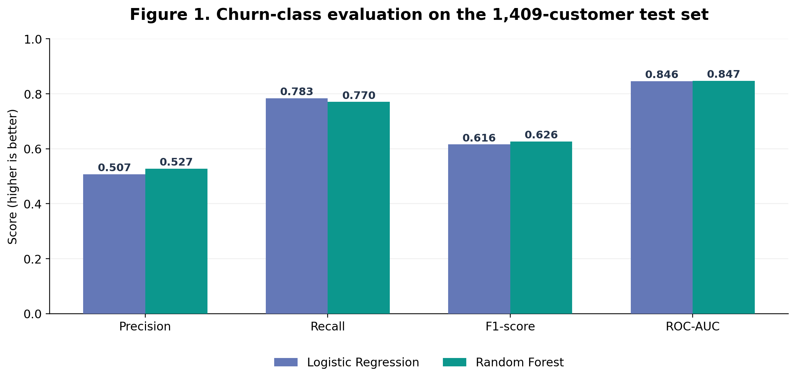
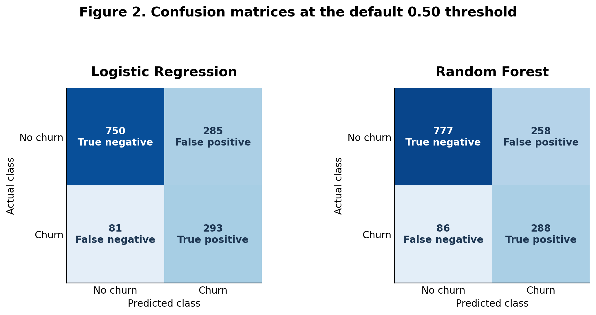
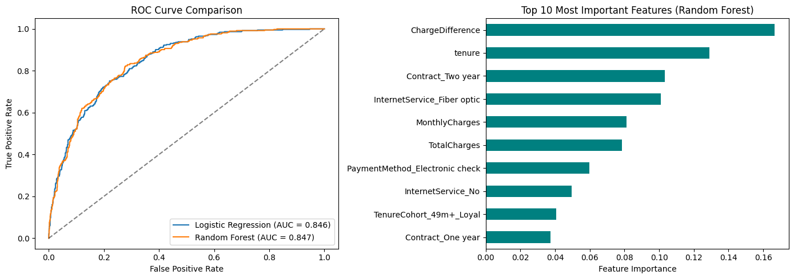

# Predicting Telecommunications Customer Churn: A Comparison of Logistic Regression and Random Forest

## Abstract

This study examined whether customer characteristics, subscribed services, contract arrangements, and billing history can predict telecommunications customer churn, and whether Random Forest improves on Logistic Regression. The IBM Telco Customer Churn dataset contained 7,043 customers. After cleaning missing charges and categorical values, three engineered predictors were added, and class-weighted Logistic Regression and Random Forest models were evaluated on a stratified 20% hold-out test set (1,409 customers). Churn-class F1-score was the primary metric, with precision, recall, and ROC-AUC used to assess trade-offs. Random Forest achieved an F1-score of 0.6261 and ROC-AUC of 0.8471, compared with 0.6155 and 0.8461 for Logistic Regression. It also improved churn precision (0.5275 vs. 0.5069), although Logistic Regression had higher recall (0.7834 vs. 0.7701). The findings suggest that Random Forest yields a small improvement in balanced classification performance, but the simpler baseline remains competitive when identifying as many potential churners as possible is the priority.

## 1. Introduction

Customer churn occurs when a subscriber ends a relationship with a service provider. For telecommunications firms, predicting which subscribers may leave can help prioritize customer-support and retention activity. Churn is difficult to predict reliably because its signals are spread across account history, pricing, contract type, and service combinations. A prediction model must also handle the fact that substantially more customers remain than leave.

Prior studies indicate that tree-based and ensemble algorithms can help identify churn patterns. Ullah et al. (2019) reported useful results from Random Forest classification and explored attributes associated with churn. Wu et al. (2021) integrated churn prediction with segmentation and addressed imbalanced training samples using SMOTE. Xu et al. (2021) examined how grouped features and ensemble learning can improve model performance. Alotaibi and Haq (2024) compared multiple machine-learning approaches, emphasizing careful evaluation of competing classifiers. In a broad literature review, Manzoor et al. (2024) highlighted the importance of model design and evaluation choices and encouraged practitioners to consider business impact as well as conventional prediction metrics.

These findings motivated a controlled comparison between a comparatively interpretable baseline and a non-linear ensemble under the same data split and preprocessing procedure. **The research question is:** *How effectively can customer demographics, service subscriptions, contract conditions, and billing features predict churn, and how much improvement does Random Forest provide over Logistic Regression?* Rather than assuming that a more complex algorithm must be superior, this study evaluates the difference using churn-class F1-score as the primary criterion, supported by ROC-AUC, precision, recall, and error counts.

## 2. Methodology

### 2.1 Dataset and outcome

The experiment used the **IBM Telco Customer Churn** sample dataset, available in the widely used 7,043-row, 21-column version (IBM, n.d.). The binary outcome, `Churn`, indicates whether a customer left within the last month; `Yes` was encoded as 1 and `No` as 0. The input data include demographics (for example, gender, partner status), account and billing characteristics (tenure, contract, payment method, monthly and total charges), and subscriptions (internet, phone, and additional services). The data were imbalanced: **26.54% churned** and **73.46% did not**.

### 2.2 Preprocessing and feature engineering

Following the first-assignment methodology, the identifier `customerID` was removed. `TotalCharges` was converted to numeric; **11 blank values** for new customers were filled with `0.0`. `No internet service` and `No phone service` labels were consolidated into `No` for relevant binary service indicators. The churn label was converted to 0/1.

Three derived features were created: (a) **`TenureCohort`**, grouping tenure into 0–12, 13–24, 25–48, and 49+ months; (b) **`TotalServicesCount`**, counting eight binary phone and add-on service indicators; and (c) **`ChargeDifference`**, calculated as `MonthlyCharges - TotalCharges / (tenure + 1)`. Categorical variables were represented with one-hot encoding (`drop_first=True`). The resulting predictor matrix had 28 columns. The numeric variables `tenure`, `MonthlyCharges`, `TotalCharges`, `TotalServicesCount`, and `ChargeDifference` were standardized using a scaler **fitted only to training data**, then applied to the test data.

### 2.3 Training procedure

The data were divided into a **stratified 80% training set (5,634 customers)** and **20% held-out test set (1,409 customers)** with `random_state=42`. Two scikit-learn models were trained using `class_weight='balanced'`: (1) Logistic Regression, configured with `max_iter=1000` and `random_state=42`; and (2) Random Forest, configured with **300 trees**, `max_depth=8`, `min_samples_leaf=10`, and `random_state=42`. The models' default probability-to-class rule (threshold 0.50) determined the reported confusion matrices. The notebook recorded one hold-out evaluation and did not document cross-validation or automated hyperparameter search.

### 2.4 Evaluation

Because a classifier predicting *no churn* for every customer would already achieve approximately 73.46% accuracy, the **positive-class F1-score** was selected as the primary metric. Churn-class **precision** measures how many customers flagged for churn actually churned, while **recall** measures how many actual churners were identified. **ROC-AUC** evaluates discrimination across decision thresholds. Confusion matrices illustrate the operational trade-off between missed churners (false negatives) and unnecessary retention interventions (false positives).

## 3. Results

The test set contained **1,035 non-churners** and **374 churners**. Table 1 summarizes both models. The reported scores are taken from the saved outputs of `experiment.ipynb`; the underlying CSV was not included among the files provided for this paper, so these were not independently retrained here.

**Table 1. Held-out test performance (churn = 1)**

| Model | Precision | Recall | F1-score | ROC-AUC | Accuracy |
|:--|--:|--:|--:|--:|--:|
| Logistic Regression | 0.5069 | **0.7834** | 0.6155 | 0.8461 | 0.7402 |
| Random Forest | **0.5275** | 0.7701 | **0.6261** | **0.8471** | **0.7559** |

*Figure 1.* Performance comparison constructed in Matplotlib from the saved experiment results. Random Forest increases F1 by **0.0106** points and ROC-AUC by **0.0010** points; these changes are small.

*Figure 2.* Error counts at the default 0.50 decision threshold. Logistic Regression generated **293 true positives**, **81 false negatives**, **285 false positives**, and **750 true negatives**. Random Forest generated **288 true positives**, **86 false negatives**, **258 false positives**, and **777 true negatives**. These integer counts reproduce the displayed precision, recall, and F1 scores to four decimal places.

*Figure 3.* Original Matplotlib output from Assignment 1/experiment notebook. The ROC curves are very close. The plotted Random Forest feature-importance ranking places `ChargeDifference`, `tenure`, `Contract_Two year`, `InternetService_Fiber optic`, and `MonthlyCharges` among the prominent features. These importances indicate how the fitted model uses features, **not** whether each variable raises or lowers churn or causes it.

## 4. Discussion

The findings answer the research question affirmatively but cautiously. Both models distinguished churners from non-churners substantially better than a random ranking would, with ROC-AUC approximately 0.85. However, moving from Logistic Regression to Random Forest produced only a **1.06 percentage-point gain in F1-score** and a **0.10 percentage-point gain in ROC-AUC** on this hold-out set. Random Forest's increase in precision meant **27 fewer false-positive flags** (258 versus 285). The cost was **five additional missed churners** (86 versus 81), resulting in slightly lower recall. For a business where contacting a non-churner is relatively expensive, the Random Forest outcome could be preferable; where missing an actual churner is costly, the Logistic Regression result merits attention. This is a business-cost trade-off rather than evidence that one model is universally best.

The observed benefit of a constrained ensemble is compatible with literature that supports model comparison and feature construction (Ullah et al., 2019; Xu et al., 2021). Yet the current experiment cannot isolate whether its engineered variables actually improved performance because it did **not** run a with-versus-without-feature ablation. `ChargeDifference` appears particularly influential in the model's impurity-based feature importances, but it is constructed directly from other billing variables and may share their information. Feature importance alone does not establish explanatory direction or causal factors.

**Limitations.** First, this is a single stratified random split, without repeated cross-validation, confidence intervals, or external validation; small differences could be sensitive to the sampled test set. Second, IBM describes the telco data as sample data for a fictional business, limiting generalizability to real operators (IBM, n.d.). Third, a cross-sectional snapshot omits shifting competitor prices, service quality, complaint history, and monthly trajectories. Fourth, both models use balanced class weights and a default threshold, but neither SMOTE, threshold optimization, nor profitability-based evaluation was tested. Finally, the Random Forest configuration was specified in the notebook rather than selected through documented systematic tuning.

**Future work** should test stratified repeated cross-validation; run feature ablations; compare SMOTE on training folds only; tune thresholds using explicit retention costs; evaluate calibration and fairness across relevant groups; and assess generalization with more recent or external customer data. These steps would make the results more decision-relevant and reduce the risk of overinterpreting a small F1 gain (Manzoor et al., 2024; Wu et al., 2021).

## 5. Conclusion

This study compared class-weighted Logistic Regression and Random Forest for predicting churn in 7,043 IBM sample telco records. On the same 1,409-customer test set, Random Forest achieved a slightly higher churn-class F1-score (0.6261 versus 0.6155) and ROC-AUC (0.8471 versus 0.8461), while Logistic Regression retained a small advantage in recall. The results suggest that an ensemble model can modestly improve the balance between correctly identifying churners and avoiding false alarms, but the simpler baseline remains competitive. Before any practical retention use, the models require further validation, threshold and cost analysis, and testing with representative operational data.

## References

Alotaibi, M. Z., & Haq, M. A. (2024). Customer churn prediction for telecommunication companies using machine learning and ensemble methods. *Engineering, Technology & Applied Science Research, 14*(3), 14572–14578. https://doi.org/10.48084/etasr.7480

IBM. (n.d.). *Telco customer churn* [Sample data documentation]. https://www.ibm.com/docs/en/cognos-analytics/12.1.x?topic=samples-telco-customer-churn

Manzoor, A., Qureshi, M. A., Kidney, E., & Longo, L. (2024). A review on machine learning methods for customer churn prediction and recommendations for business practitioners. *IEEE Access, 12*, 70434–70463. https://doi.org/10.1109/ACCESS.2024.3402092

Ullah, I., Raza, B., Malik, A. K., Imran, M., Islam, S. U., & Kim, S. W. (2019). A churn prediction model using random forest: Analysis of machine learning techniques for churn prediction and factor identification in telecom sector. *IEEE Access, 7*, 60134–60149. https://doi.org/10.1109/ACCESS.2019.2914999

Wu, S., Yau, W.-C., Ong, T.-S., & Chong, S.-C. (2021). Integrated churn prediction and customer segmentation framework for telco business. *IEEE Access, 9*, 62118–62136. https://doi.org/10.1109/ACCESS.2021.3073776

Xu, T., Ma, Y., & Kim, K. (2021). Telecom churn prediction system based on ensemble learning using feature grouping. *Applied Sciences, 11*(11), Article 4742. https://doi.org/10.3390/app11114742

---
